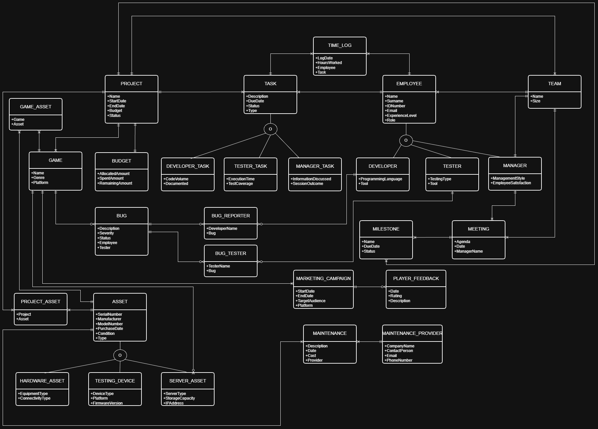

# Vortex Game Studio Database

A relational database for a fictional game development studio, built in MySQL 8.
It covers the studio's employees, teams, projects, tasks, bugs, assets,
maintenance, and marketing campaigns across 28 tables.

## The scenario

Vortex Game Studio is a video game development startup. Its founder needs a
system to manage the business side of the studio. The system tracks staff and
teams, projects with their budgets and milestones, tasks and bugs, equipment
and its maintenance, and marketing campaigns with player feedback.

The full scenario is in
[`docs/01-business-scenario.pdf`](docs/01-business-scenario.pdf).

## The three phases

| Phase | Description | File |
|---|---|---|
| 1. Requirements | A business scenario describing how the studio operates | `docs/01-business-scenario.pdf` |
| 2. Design | The scenario modelled as an ER diagram and relational schema | `docs/02-er-diagram.pdf` |
| 3. Implementation | The database, with constraints, triggers, and stored procedures | `sql/schema.sql` |



## What's in the database

- **People:** employees, with developer, tester, and manager subtypes, grouped into teams
- **Work:** projects, tasks (with a subtype per role), time logs, meetings, and milestones
- **Products:** games, bugs, bug reporters, and assigned testers
- **Equipment:** assets (hardware, testing devices, and servers) linked to the projects and games that use them, plus maintenance records and providers
- **Marketing:** campaigns and player feedback
- **Finance:** one budget per project

Business rules are enforced in the database itself:

- **Constraints:** primary and foreign keys, plus `CHECK` constraints on IDs, dates, amounts, and allowed values
- **Triggers:** a bug moves to "In Progress" when a tester is first assigned, and a project is marked "Completed" when its last open task is completed
- **Stored procedures:** `transfer_task_ownership` moves a task to another employee after checking that the task exists, the new owner exists, and the task belongs to the stated current owner; `update_task_status_from_logs` sets a task's status from its logged hours

## How to run it

Requires MySQL 8.0.16 or later.

Clone the repo and start the MySQL client from inside it:

```
git clone https://github.com/tevineleven11/gamedev-management-db.git
cd gamedev-management-db
mysql -u root -p
```

Then run the files in this order:

```
source sql/schema.sql
source sql/seed.sql
source sql/queries.sql
```

If the client was started from somewhere else (for example, from the MySQL
Command Line Client shortcut on Windows), use the full path with forward slashes:

```
source C:/path/to/gamedev-management-db/sql/schema.sql
```

## Example queries

`sql/queries.sql` answers twelve questions about the studio:

| # | Question | Technique |
|---|---|---|
| 1 | Which tasks are still open, and who owns them? | Multi-table join |
| 2 | How many hours has each employee logged? | `GROUP BY`, aggregates |
| 3 | How many bugs does each game have, by severity? | Conditional aggregation |
| 4 | Which employees have no tasks? | `LEFT JOIN` with `IS NULL` |
| 5 | Which assets needed maintenance more than once? | `HAVING` |
| 6 | How much of its budget has each project spent? | Calculated columns |
| 7 | Which campaigns and audiences earn the best feedback? | `LEFT JOIN`, aggregates |
| 8 | How do testers rank by bugs assigned? | Window function (`RANK`) |
| 9 | Which employees reported more than one bug? | Correlated subquery |
| 10 | Which developer tasks involved more code than average? | Non-correlated subquery |
| 11 | Which milestones are outstanding, and where were they discussed? | Mixed `JOIN` and `LEFT JOIN` |
| 12 | Who manages each team, and how big is it? | Joining a table twice |

Sample output from query 3:

```
+----------------+------------+----------+------+--------+------+
| game_name      | total_bugs | critical | high | medium | low  |
+----------------+------------+----------+------+--------+------+
| Dungeon Ledger |          4 |        1 |    2 |      0 |    1 |
| Pocket Farm    |          2 |        0 |    0 |      1 |    1 |
| Skyward Racer  |          2 |        0 |    1 |      1 |    0 |
| Orbit Tactics  |          0 |        0 |    0 |      0 |    0 |
+----------------+------------+----------+------+--------+------+
```

Sample output from query 7, which shows Skyward Racer landing better with
hardcore gamers than with a general TV audience:

```
+-------------+----------------+-----------------+--------------+----------------+------------+
| campaign_id | game_name      | target_audience | platform     | feedback_count | avg_rating |
+-------------+----------------+-----------------+--------------+----------------+------------+
|           1 | Skyward Racer  | Hardcore Gamers | Influencers  |              3 |       4.17 |
|           3 | Pocket Farm    | Casual Players  | Social Media |              3 |       4.08 |
|           4 | Dungeon Ledger | Teens           | Online Ads   |              1 |       4.00 |
|           2 | Skyward Racer  | All Ages        | TV           |              2 |       3.25 |
+-------------+----------------+-----------------+--------------+----------------+------------+
```

## Design notes

- Some details changed between the scenario and the implementation. Status
  values and equipment categories were refined (for example, tasks can be
  "Blocked"), and player feedback is stored as a rating from 0 to 5 in place of
  a yes/no purchase intent.
- Estimated hours per task type are hard-coded in `update_task_status_from_logs`.
